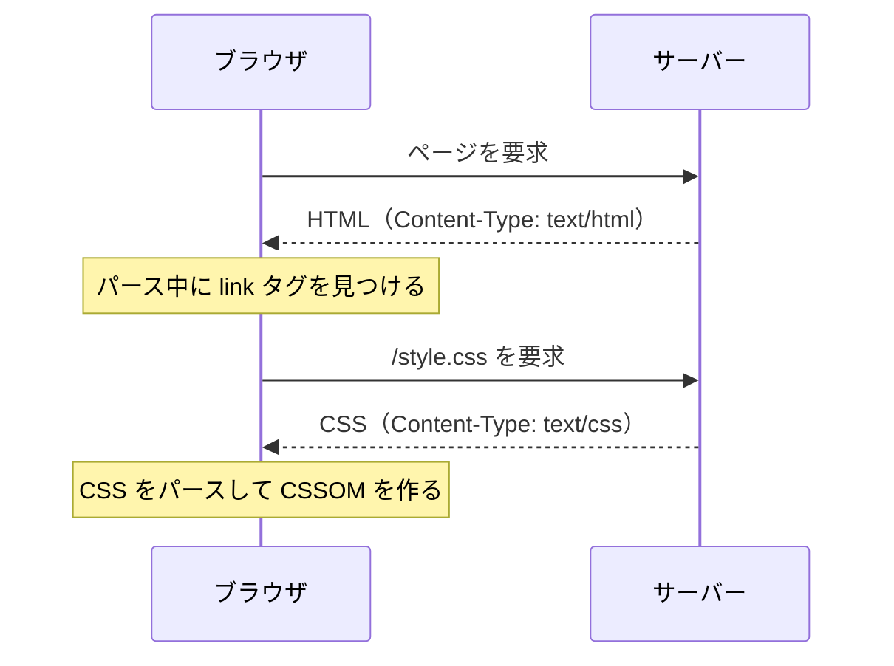
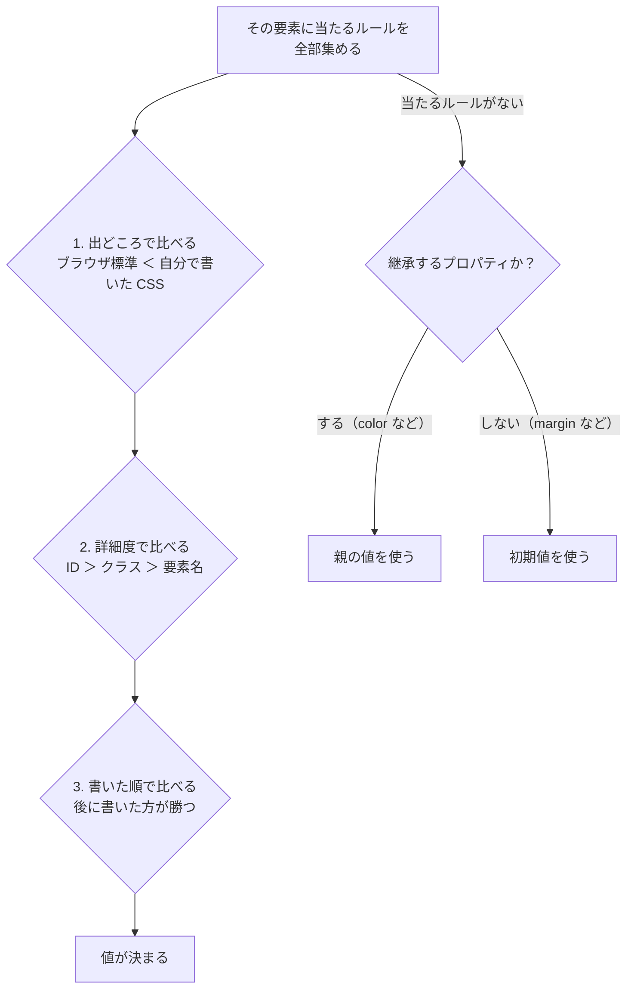
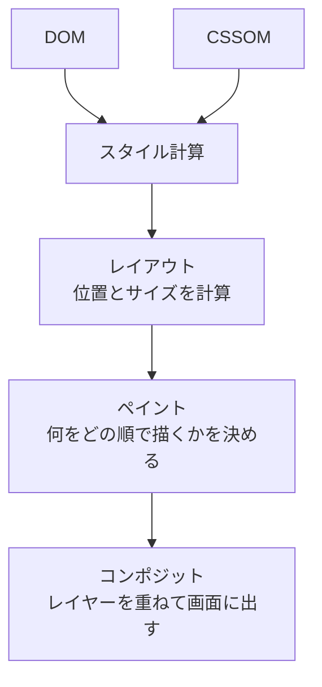

[HTML 編](https://zenn.dev/tora29/articles/how-browser-renders-html)では、HTML の文字列が DOM という木構造になるまでを追いかけました。今回の CSS 編では、CSS が読み込まれ、DOM と合わせて画面に描かれるまでを見ていきます。

## CSS はどうやって読み込まれるか

CSS は、HTML とは**別のファイルとして、あとから取りに行く**のが基本です。



HTML のパース中に `<link rel="stylesheet" href="/style.css">` を見つけると、ブラウザはその URL に**別のリクエスト**を出します。開発者ツールの Network パネルを見ると、HTML とは別の行に CSS が並んでいます。ちなみにブラウザは、HTML を先読みして `<link>` を早めに見つける仕組み（プリロードスキャナー）も持っています。

CSS の書き方によって、読み込まれ方が変わります。

| 書き方 | 読み込まれ方 |
| --- | --- |
| `<link rel="stylesheet" href="...">` | 別のリクエストで取りに行く。一番ふつうの方法 |
| `<style>...</style>` | HTML の中に直接書いてあるので、追加のリクエストはない |
| `style="..."` 属性 | 要素に直接書いてあるので、追加のリクエストはない |
| CSS の中の `@import url(...)` | CSS を読んでから、さらに次の CSS を取りに行く。直列になるので遅くなりやすい |
| ブラウザ標準の CSS | ブラウザに組み込まれているので、読み込みはない |

### HTML に CSS を埋め込む場合

CSS は、別ファイルにせず、HTML の中に直接書くこともできます。書き方は2つあります。

```html
<head>
  <!-- <style> 要素：ページの中にまとめて書く -->
  <style>
    h1 { color: tomato; }
  </style>
</head>
<body>
  <!-- style 属性：その要素だけに直接書く -->
  <p style="color: gray;">こんにちは</p>
</body>
```

- **`<style>` 要素**：パーサーが `<style>` を読んだ時点で、中身を CSS としてパースします。取りに行く必要がないので、リクエストが1回減ります
- **`style` 属性**：その要素だけに当たります。セレクターを書かないので、ほかの要素には効きません

別ファイルにするか埋め込むかで、次のような違いがあります。

| | 別ファイル（`<link>`） | 埋め込み（`<style>`） |
| --- | --- | --- |
| リクエスト | CSS のぶん1回増える | 増えない |
| キャッシュ | ブラウザが CSS ファイルを保存しておけるので、2ページ目以降は取りに行かずに済むことが多い | HTML の一部なので、ページを開くたびに一緒に届く |
| 向いているもの | サイト全体で使う大きな CSS | そのページでしか使わない小さな CSS や、最初の表示に必要な最小限の CSS（クリティカル CSS） |

HTML 編で使った [example.com](https://example.com) も、CSS を `<style>` で埋め込んでいます。ページが1枚で CSS も小さいサイトなら、この方がリクエストが減り、早く表示できます。

## CSS は CSSOM になる

読み込んだ CSS は、HTML と同じようにパースされて **CSSOM（CSS Object Model）** になります。どの要素にどのスタイルが当たるかを計算するための構造です。

## どのスタイルが当たるかはどう決まるか

1つの要素には、ブラウザ標準の CSS、自分で書いた CSS、`style` 属性など、いろいろなところから CSS が当たります。同じプロパティに、複数のルールがぶつかることも珍しくありません。

```html
<p id="lead" class="note">こんにちは</p>
```

```css
p      { color: black; }
.note  { color: green; }
#lead  { color: red; }
```

この `<p>` の文字は何色になるでしょうか？ 答えは赤です。ブラウザは、要素ごと・プロパティごとに、次の順番で「どの値を使うか」を決めています。



この「複数の候補から1つを選ぶ仕組み」を**カスケード**と呼びます。CSS の C（Cascading）は、これのことです。

### 1. 出どころ

自分で書いた CSS は、ブラウザ標準の CSS に勝ちます。`<h1>` はブラウザ標準では太字ですが、`h1 { font-weight: normal; }` と書けば細くなるのはこのためです。

なお、`!important` を付けた宣言は、この出どころの段階で一緒に比べられ、詳細度や書いた順に関係なく、付けていない宣言に勝ちます。強すぎて後から上書きしにくくなるので、多用しない方がいいと言われます。

### 2. 詳細度

出どころが同じなら、セレクターの**詳細度**で比べます。詳細度は、セレクターに含まれる部品の数を、次の3つの桁で数えたものです。

| セレクター | ID | クラス・属性・疑似クラス | 要素名 |
| --- | --- | --- | --- |
| `p` | 0 | 0 | 1 |
| `.note` | 0 | 1 | 0 |
| `article .note` | 0 | 1 | 1 |
| `#lead` | 1 | 0 | 0 |

左の桁から比べて、大きい方が勝ちます。クラスをいくつ重ねても、ID 1つには勝てません。最初の例で `#lead` の赤が勝ったのは、これが理由です。

ちなみに、`style` 属性に直接書いたスタイルは、セレクターで書いたどのルールよりも強くなります（`!important` を付けたルールは除きます）。

### 3. 書いた順

出どころも詳細度も同じなら、**後に書いた方が勝ちます**。

```css
.note { color: green; }
.note { color: blue; }   /* こちらが勝つ */
```

### 当たるルールがないとき：継承と初期値

どのルールも当たらなかったプロパティは、**継承**するかどうかで決まります。

- `color` や `font-size` など、文字に関するプロパティの多くは継承する。親の値をそのまま使う
- `margin` や `border` など、箱に関するプロパティの多くは継承しない。そのプロパティの初期値を使う

`body { color: #333; }` と1か所書くだけでページ全体の文字色が変わるのは、`color` が継承されるからです。逆に、`border` まで子に継承されたら、すべての要素に枠が付いてしまいます、、。

### 最終的な値は確かめられる

こうして決まった最終的な値は、開発者ツールの Elements パネルの **Computed** タブで確かめられます。**Styles** タブでは、負けたルールに取り消し線が引かれていて、どのルールが勝ったかが分かります。

JavaScript からは、`getComputedStyle` で取れます。

```js
getComputedStyle(document.querySelector("#lead")).color;
// → "rgb(255, 0, 0)"
```

この「要素ごとに、すべてのプロパティの値を決める」作業が、あとで出てくる描画の工程の「スタイル計算」です。

## CSS は描画をブロックする

`<head>` の `<link rel="stylesheet">` で読み込む CSS は、**描画をブロック**します。ブラウザは、CSS を読み終わるまで画面を描きません。

### FOUC とは

FOUC（Flash of Unstyled Content）は、**スタイルが当たっていないページが一瞬だけ見えてしまう現象**です。ページを開いた瞬間に、ブラウザ標準の CSS だけが当たった素の HTML が表示され、少し遅れて CSS が当たって、見た目がガクッと切り替わります。


もしブラウザが CSS を待たずに描き始めると、まずブラウザ標準の CSS だけで描き（左）、CSS が届いたらスタイル計算からやり直して描き直す（右）ことになります。左の画面が一瞬見えてしまうのが FOUC です。

これを防ぐために、ブラウザは `<head>` の CSS がそろうまで描画を待ちます。その代わり、CSS が重いと最初の表示が遅くなります。「崩れた画面を一瞬見せる」より「少し待たせて整った画面を見せる」方を、ブラウザは選んでいるわけです。

### それでも FOUC が起きるとき

描画を待ってくれるのは、基本的に `<head>` に書かれた CSS です。次のような場合は、CSS が届く前に描画が始まり、FOUC が起きることがあります。

- JavaScript で、あとから CSS を読み込んだり `<style>` を差し込んだりする
- `<link rel="stylesheet">` を `<body>` の後ろの方に書く

## スタイル計算 → レイアウト → ペイント → コンポジット

DOM と CSSOM をもとに、いよいよ画面を描きます。



1. **スタイル計算**：DOM の各要素に、最終的にどのスタイルが当たるかを決めます。`display: none` の要素は、この後の工程から外れます
2. **レイアウト**：各要素の位置と大きさを計算します。画面幅が変わると、ここからやり直しになります（リフロー）
3. **ペイント**：背景・枠線・文字・画像を、どの順で描くかを決めます
4. **コンポジット**：描いたものをレイヤーごとにまとめ、GPU で重ねて画面に出します

## 工程が分かると説明できること

`display: none` と `visibility: hidden` の違いもここで分かります。`display: none` はレイアウトから外れるので場所も取りませんが、`visibility: hidden` はレイアウトには残り、描かれないだけです。

アニメーションに `transform` と `opacity` を使うとよいと言われるのも、この工程が理由です。`width` や `top` を動かすとレイアウトからやり直しになりますが、`transform` と `opacity` はコンポジットだけで済むことが多く、そのぶん軽く動きます。

## まとめ

- CSS は、`<link>` で別ファイルとして取りに行くか、`<style>` や `style` 属性で HTML に埋め込む
- 読み込んだ CSS はパースされて CSSOM になる
- どのスタイルが当たるかは、出どころ → 詳細度 → 書いた順で決まる（カスケード）。当たらなければ継承か初期値になる
- `<head>` の CSS は描画をブロックする。待たずに描くと、スタイルのない画面が一瞬見える（FOUC）
- 描画は、スタイル計算 → レイアウト → ペイント → コンポジットの順に進む
- どの工程からやり直しになるかで、変更の重さが変わる

次の JavaScript 編では、スクリプトが HTML の解析を止める理由と、DOM を書き換えたときに起きることを追いかけます。
