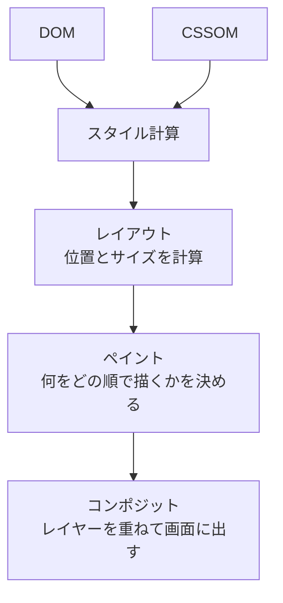

[HTML 編](https://zenn.dev/tora29/articles/how-browser-renders-html)では、HTML の文字列が DOM という木構造になるまでを追いかけました。今回の CSS 編では、CSS が読み込まれ、DOM と合わせて画面に描かれるまでを見ていきます。

## CSS は CSSOM になる

`<link rel="stylesheet">` などで CSS が見つかると、HTML と同じようにパースされて **CSSOM（CSS Object Model）** になります。どの要素にどのスタイルが当たるかを計算するための構造です。

## CSS は描画をブロックする

CSS は**描画をブロック**します。CSS を読み終わる前に描画すると、スタイルが当たっていない画面が一瞬見えてしまう（いわゆる FOUC）ため、ブラウザは CSS がそろうまで画面を描きません。CSS が重いと、最初の表示が遅くなるのはこのためです。

## スタイル計算 → レイアウト → ペイント → コンポジット

DOM と CSSOM がそろうと、いよいよ画面を描きます。

1. **スタイル計算**：DOM の各要素に、最終的にどのスタイルが当たるかを決めます。`display: none` の要素は、この後の工程から外れます
2. **レイアウト**：各要素の位置と大きさを計算します。画面幅が変わると、ここからやり直しになります（リフロー）
3. **ペイント**：背景・枠線・文字・画像を、どの順で描くかを決めます
4. **コンポジット**：描いたものをレイヤーごとにまとめ、GPU で重ねて画面に出します

## 工程が分かると説明できること

`display: none` と `visibility: hidden` の違いもここで分かります。`display: none` はレイアウトから外れるので場所も取りませんが、`visibility: hidden` はレイアウトには残り、描かれないだけです。

アニメーションに `transform` と `opacity` を使うとよいと言われるのも、この工程が理由です。`width` や `top` を動かすとレイアウトからやり直しになりますが、`transform` と `opacity` はコンポジットだけで済むことが多く、そのぶん軽く動きます。

## まとめ

- CSS はパースされて CSSOM になる
- CSS は描画をブロックする。そろうまで画面は描かれない
- 描画は、スタイル計算 → レイアウト → ペイント → コンポジットの順に進む
- どの工程からやり直しになるかで、変更の重さが変わる

次の JavaScript 編では、スクリプトが HTML の解析を止める理由と、DOM を書き換えたときに起きることを追いかけます。
