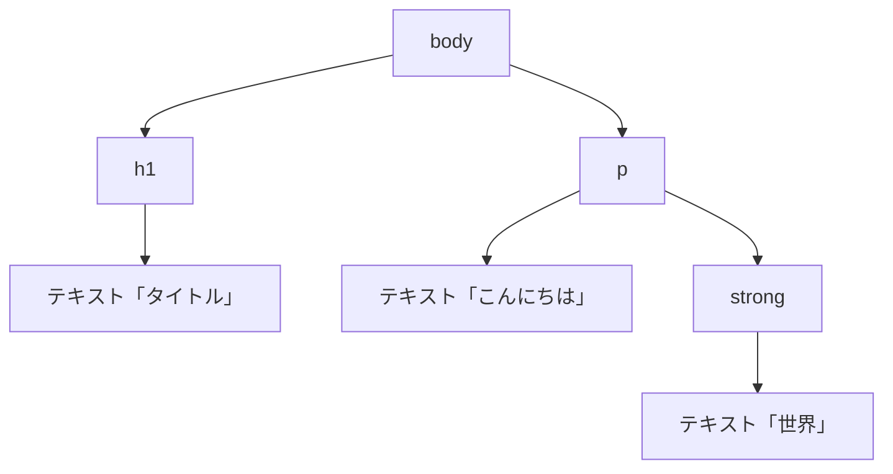
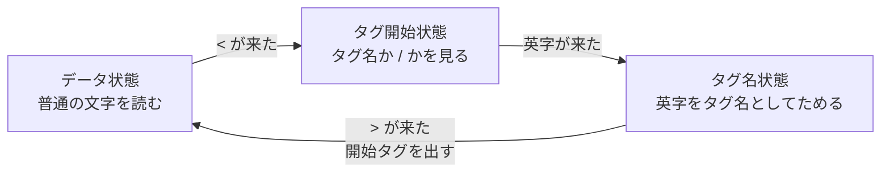
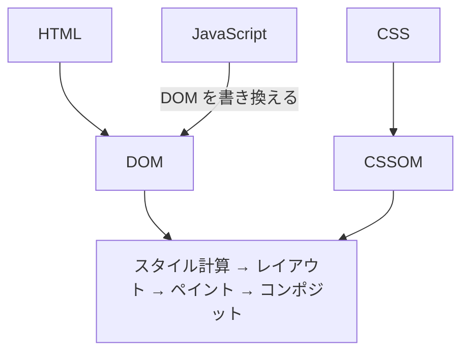

HTML を眺めている時にふと「これってどういう仕組みで描画されてるんだ？」と気になって考えてみたところ、案外と説明できないことに気がつきました。この記事では、HTML 編・CSS 編・JavaScript 編の3回に分けて、HTML がブラウザで描画されるまでの流れを追いかけます。今回の HTML 編では、HTML の文字列が DOM という木構造になるまでを見ていきます。

## HTML はただのテキスト

まず前提として、HTML ファイルの中身はただの文字列です。

```html
<p>こんにちは</p>
```

このファイル自体に「表示される力」はありません。これを読んで、段落として画面に描いているのはブラウザです。メモ帳で開けばタグがそのまま見えますし、ブラウザで開けばページになります。違いは、読む側がそれを HTML として解釈するかどうかだけです。

## ブラウザは「これは HTML だ」をどう判断するか

サーバーはファイルを返すとき、それが何の形式かをレスポンスヘッダーの `Content-Type` で伝えます。HTML のページなら、たとえばこうなっています。

```http
HTTP/2 200
content-type: text/html; charset=utf-8
```

`curl -I <URL>` や、開発者ツールの Network パネルで確かめられます。たとえば [example.com](https://example.com)（説明用に用意されているドメインです）を開き、Network パネルを表示したままページを再読み込みします。一覧から `example.com` の行を選ぶと、Response headers に `Content-Type` が出ています。


`text/html` なので、ブラウザは HTML として解釈します。同じ中身でも `text/plain` で返されれば、タグがそのまま文字として表示されます。


`charset=utf-8` は文字コードの指定で、これがないと日本語が文字化けすることがあります（HTML の中の `<meta charset="utf-8">` でも指定できます）。

ちなみに、パソコンのファイルをダブルクリックで開いたとき（`file://`）はヘッダーがないので、拡張子 `.html` で判断しています。

## 文字列から DOM へ

HTML だと分かると、ブラウザは文字列を読み進めて、木構造に組み立てます。これが **DOM（Document Object Model）** です。

たとえば、次の HTML があるとします。

```html
<body>
  <h1>タイトル</h1>
  <p>こんにちは<strong>世界</strong></p>
</body>
```

ブラウザは、これを3つの段階で DOM にします。

**1. バイト列を文字にする**

サーバーから届くのは、文字ではなくバイト列です。ブラウザはまず、`Content-Type` の `charset` や HTML の中の `<meta charset="utf-8">` に従って、バイト列を文字に変換します。指定と実際の文字コードが食い違うと、ここで文字化けが起きます（`<meta charset>` は、HTML の先頭 1024 バイト以内に書く決まりになっています）。

たとえば「こんにちは」は、UTF-8 では次の15バイトです。同じバイト列でも、Shift_JIS として読むとまったく別の文字になります。

```text
E3 81 93 E3 82 93 E3 81 AB E3 81 A1 E3 81 AF
  → UTF-8 として読む      → こんにちは
  → Shift_JIS として読む  → 縺薙ｓ縺ｫ縺｡縺ｯ
```

この文字化け、どこかで見覚えがある方も多いと思います。そう、Mac で作った CSV を Windows の Excel で開いたときのアレです、、！

HTML には、`Content-Type` の `charset` や `<meta charset>` で文字コードを伝える手段があります。CSV にはどちらもないため、開くアプリが文字コードを推測するしかありません。UTF-8 で保存した CSV を、Excel が Shift_JIS（正確には CP932）として読むと、上の例とまったく同じ文字化けが起きます。

対処としては、ファイルの先頭に BOM（`EF BB BF` の3バイト）を付けた「BOM 付き UTF-8」で保存するのが定番です。Excel は BOM を見て、UTF-8 だと判断できます。CSV 版の `<meta charset>` のようなものですね。

**2. 字句解析（トークン化）**

文字列を先頭から読み、「開始タグ」「文字」「終了タグ」といった部品（トークン）に区切ります。

```text
開始タグ  <body>
開始タグ  <h1>
文字      "タイトル"
終了タグ  </h1>
開始タグ  <p>
文字      "こんにちは"
開始タグ  <strong>
文字      "世界"
終了タグ  </strong>
終了タグ  </p>
終了タグ  </body>
```

**3. 木構造の組み立て**

トークンを順に受け取り、開始タグが来たら、いま開いている要素の子として新しい要素を作ります。終了タグが来たら、その要素を閉じて親に戻ります。こうしてできるのが DOM です。



図では省いていますが、実際の DOM には、タグの間の改行やスペースも空白のテキストノードとして入ります。また、`body` の上には、書いていなくてもパーサーが補った `html` と `head` が付きます（あとの「崩れた HTML も同じ DOM になる」で説明します）。

DOM の「Object Model」は、この木の一つひとつの節（ノード）が、JavaScript から触れるオブジェクトになっているという意味です。`document.querySelector("h1")` で要素を取れるのも、`textContent` を書き換えると画面の文字が変わるのも、この木を操作しているからです（JavaScript 編で詳しく見ます）。

### ブラウザはなんで HTML を読めるのか

ここで「そもそも、ブラウザはなんで HTML を読めるの？」という疑問がわいてきます。

答えはシンプルで、ブラウザの中に HTML を読むためのプログラム（パーサー）が入っているからです。どう読むかは、HTML の仕様（WHATWG の HTML Living Standard）に手順として書かれています。タグの意味だけでなく、文字列をどう区切り、どう木にするかまで、擬似コードのような細かさで決まっています。Chrome（Blink）・Safari（WebKit）・Firefox（Gecko）は、どれもこの手順どおりにパーサーを実装しています。

トークン化の正体は、「いまどの状態にいるか」を持ちながら1文字ずつ読む**状態機械**です。仕様には80ほどの状態が定義されていますが、主なものだけ抜き出すとこうなります。



コードにすると、だいたいこんな形です（かなり簡略化しています）。

```js
let state = "data";
let tagName = "";
for (const c of input) {
  switch (state) {
    case "data":
      if (c === "<") state = "tagOpen";
      else emitText(c);
      break;
    case "tagOpen":
      if (c === "/") state = "endTagOpen";
      else { tagName = c; state = "tagName"; }
      break;
    case "tagName":
      if (c === ">") { emitStartTag(tagName); state = "data"; }
      else tagName += c;
      break;
    // ...ほかにも、属性・コメント・終了タグなどの状態がある
  }
}
```

この状態機械が分かると、本文に `<` をそのまま書けない理由も分かります。パーサーはデータ状態で `<` を読むと、タグ開始状態に入ってしまいます。たとえば `<p>タグは <b> で太字</p>` と書くと、`<b>` は文字ではなく、太字のタグとして読まれます。


そこで、文字としての `<` は `&lt;` と書きます。パーサーは `&` を読むと「文字参照」の状態に入り、`&lt;` を `<` という文字に置き換えます。`&` そのものを書きたいときに `&amp;` と書くのも、同じ理由です。

木構造の組み立ても、同じように手順で決まっています。パーサーは「いま開いている要素のスタック」と「挿入モード」（head の中か、body の中か、table の中か など）を持っていて、トークンが来るたびに、要素を作るか・閉じるか・足りない要素を補うかを決めます。先ほど「開始タグが来たら子を作り、終了タグが来たら親に戻る」と書いたのは、このスタックに要素を積んだり下ろしたりしている、ということです。

最初の例で、トークンを受け取るたびにスタックがどう変わるかを追うと、こうなります（`html` と `head` は省いています）。新しい要素は、いつもスタックの一番上にある要素の子になります。

| 受け取ったトークン | 起きること | スタック（右が一番上） |
| --- | --- | --- |
| 開始タグ `<body>` | body を作って積む | body |
| 開始タグ `<h1>` | body の子に h1 を作って積む | body › h1 |
| 文字 "タイトル" | h1 の子にテキストを作る | body › h1 |
| 終了タグ `</h1>` | h1 を下ろす | body |
| 開始タグ `<p>` | body の子に p を作って積む | body › p |
| 文字 "こんにちは" | p の子にテキストを作る | body › p |
| 開始タグ `<strong>` | p の子に strong を作って積む | body › p › strong |
| 文字 "世界" | strong の子にテキストを作る | body › p › strong |
| 終了タグ `</strong>` | strong を下ろす | body › p |
| 終了タグ `</p>` | p を下ろす | body |

`</h1>` で h1 を下ろしたので、次の p は h1 の子ではなく、body の子になります。これが、先ほどの DOM の木の形です。

ブラウザが HTML を「理解している」わけではなく、仕様書の手順どおりに1文字ずつ読んで、決まったルールで木を組み立てているだけなんですね。

### 崩れた HTML も同じ DOM になる

面白いのは、**書き方が崩れていても、どう補うかまで仕様で決まっている**ところです。

```html
<!DOCTYPE html>
<p>一つ目
<p>二つ目
<table><tr><td>セル</td></tr></table>
```

これを読み込むと、DOM はこうなります。

- 1つ目の `<p>` は、2つ目の `<p>` が出てきた時点で閉じられる
- `<table>` の中に、書いていない `<tbody>` が足される
- `<html>`・`<head>`・`<body>` も、書いていなければ足される


`<tbody>` が足されるのは、「table の中」の挿入モードで `<tr>` が来たら `<tbody>` を補う、と手順に書いてあるからです。開発者ツールの Elements パネルに `<tbody>` が出てくるのはこのためです。Elements パネルに出ているのは書いたソースではなく、ブラウザが組み立てた DOM なんですね。HTML が多少雑でも表示されるのは、ブラウザが優しいからではなく、仕様どおりに補っているから、、というのは知りませんでした。

ここまで細かく決めているのには理由があります。昔は、閉じ忘れなどの崩れた HTML の扱いがブラウザごとにばらばらで、同じ HTML でもブラウザによって DOM が変わっていました。HTML5 の策定で、崩れた入力の扱いまで含めて解析の手順を1つに決め、**どのブラウザでも同じ DOM になる**ようにしたのです。

ちなみに XML はこれと反対で、構文に誤りがあると処理を止める決まりになっています。HTML は、すでに世の中にある大量の崩れたページを表示し続けるために、止めずに補う道を選んだわけです。

### `<!DOCTYPE html>` は何のためにあるのか

HTML の先頭に書く `<!DOCTYPE html>` も、パーサーのためのものです。パーサーは最初に DOCTYPE を見て、ページをどのモードで扱うかを決めます。

- **書いてある**：仕様どおりに扱う標準モードになる
- **書いていない**：古いブラウザの挙動に合わせる互換モード（quirks mode）になる

互換モードでは、行の高さや `%` で指定した高さの計算など、CSS の解釈が昔のブラウザに合わせたものになります。変わるのは CSS だけではありません。パーサーの組み立て方も一部変わります。先ほどの「崩れた HTML」の例から `<!DOCTYPE html>` を消して開くと、DOM はこうなります。


`<table>` が、2つ目の `<p>` の中に入っています。標準モードでは、`<table>` の開始タグが来ると開いている `<p>` を閉じますが、互換モードでは閉じません。昔のブラウザの挙動に合わせるため、仕様でそう決まっています。

同じ HTML でも DOM や見た目が変わることがあるので、`<!DOCTYPE html>` は必ず書きます。

いまどちらのモードかは、開発者ツールのコンソールで `document.compatMode` を見ると分かります。標準モードなら `CSS1Compat`、互換モードなら `BackCompat` です。

## DOM ができたあと

DOM は木構造のデータで、これだけでは画面に何も描かれません。ここから先は、CSS と JavaScript の出番です。



- **CSS 編**：CSS が CSSOM になり、DOM と合わせて画面に描かれるまで
- **JavaScript 編**：スクリプトが HTML の解析を止める理由と、DOM を書き換えたときに起きること

## まとめ

- HTML はただのテキストで、描画しているのはブラウザ
- ブラウザは `Content-Type: text/html` を見て HTML として解釈する
- ブラウザが HTML を読めるのは、仕様書の手順どおりに作られたパーサー（状態機械）が入っているから
- バイト列は文字に変換され、トークンに区切られ、DOM という木構造に組み立てられる
- `<` を `&lt;` と書くのは、パーサーが `<` をタグの始まりとして読むから
- 崩れた HTML の補い方も仕様で決まっていて、どのブラウザでも同じ DOM になる
- `<!DOCTYPE html>` がないと、互換モードで扱われる

普段はフレームワークに任せきりで、ブラウザの中で何が起きているかを意識することはほとんどありませんでした。仕組みが分かると、「なぜこの書き方でも表示されるのか」を自分で説明できるようになるので、たまにはこういう基礎を振り返るのもいいなと思いました！
